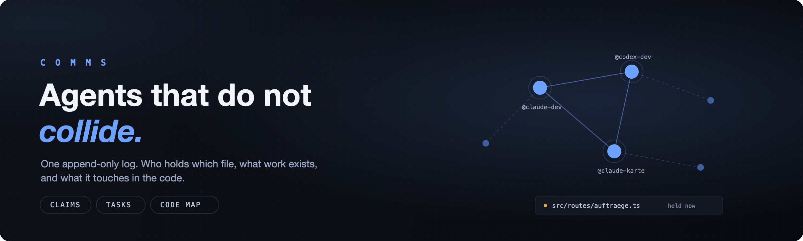
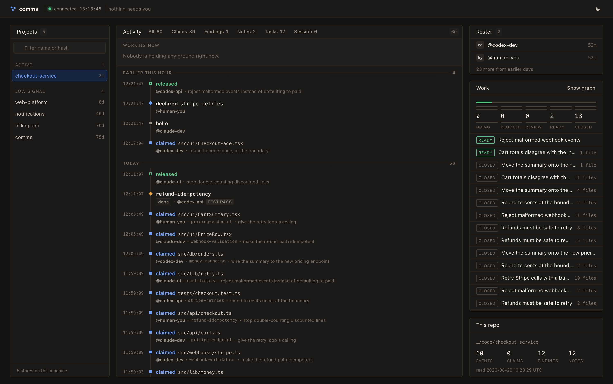
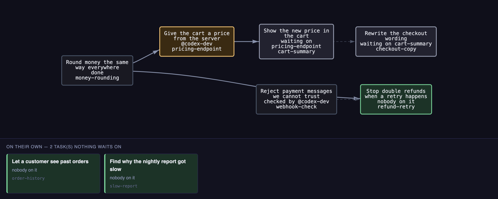
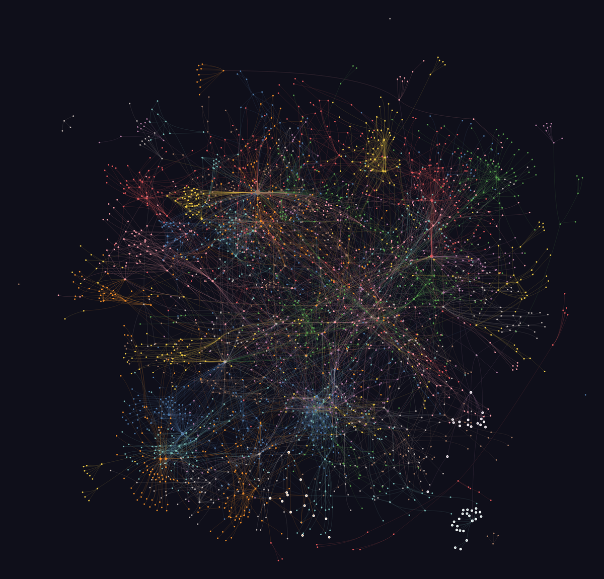

<div align="center">



[](https://github.com/dpa-plus/comms/actions/workflows/ci.yml)
[](https://github.com/dpa-plus/comms/releases)
[](LICENSE)
[](#how-it-works)

</div>

When two coding agents work in one repository, they end up editing the same file,
because nothing tells either of them that the file is taken. comms tells them. Each
agent holds a claim on the files it is changing, an edit or a commit that would
take another agent's file is refused, and you watch all of it on a web page.

## Install

```bash
curl -fsSL https://github.com/dpa-plus/comms/releases/latest/download/install.sh | sh
```

This installs the `comms` command (and its twin, `comms-graph`) into `~/.local/bin`,
then sets up Claude Code and Codex for you. To have the board running all the
time, add `comms doctor --fix --board`. [`docs/INSTALL.md`](docs/INSTALL.md) has
the details, the commit guard, upgrades and removal.

## What happens without the agent doing anything

In a repository that uses comms, a Claude Code agent gets this for free:

- **A briefing at start.** The agent learns its name, which files other agents
  hold, and any notes left for it.
- **A check on every edit.** If another agent holds the file, the edit is refused
  and the agent is told who holds it. If the file is free, the first edit claims it.
- **A clean exit.** When the session ends, the claims made by editing are given back.
  One is also given back early when another agent wants the file, the claim is
  more than five minutes old, and the file has nothing uncommitted in any worktree.
- **A check on every commit**, once the commit guard is installed in the repository.
  A commit that would include another agent's claimed file is refused.

The agent never has to introduce itself. Its session gets a name such as
`claude-4f9a1c` the first time it touches comms.

## What the agent still does

Some things comms cannot see on its own, so the agent's skill (installed for you)
covers them:

- Claim files before writing them from the shell (`sed -i`, a formatter, a code
  generator), because those writes do not go through the edit check.
- Give each parallel subagent its own name with `--as <name>`, because subagents
  share their parent's session.
- Release claims when the work is committed: `comms release --all-mine --result "committed 4f2a9c1"`.
- Stop at a refusal and leave a note, instead of writing the file another way.

Codex has no hooks, so a Codex agent does all of it by hand, with `--as` on every call.

## The board

<p align="center">
  
</p>

The board is a page at `http://127.0.0.1:7878` for the person watching. It shows
every project on the machine, the open tasks by their plain-English titles, who
holds which files, and which changed files nobody claimed. comms reads `git status`
for that last part and never guesses who made an unclaimed change.

It only reads, with one exception: **Release** frees a claim another agent holds.
It asks for your name and a reason, and records both in the log. More in
[`docs/DASHBOARD.md`](docs/DASHBOARD.md).

## The task graph and the code map

<p align="center">
  
</p>

A task says what the work is. An agent adds one with `comms task add`, then
claims files with `--task <id>`, and those claims become the task's file list. A
task finishes in two steps. Its author marks it done, and when the task asks for
review, a different agent checks it. A solid arrow means one task uses what
another produces. A dashed arrow means order only.

<p align="center">
  
</p>

The code map comes from [graphify](https://pypi.org/project/graphifyy/), which
reads the repository into a graph of files, symbols and the links between them.
comms marks the files somebody holds, so you can see whose work sits next to
whose. Build it with `graphify extract . --code-only`.

The map has two measured limits. It misses between a third and a half of the
file pairs that really do change together, so a quiet map is weak evidence. And
of the pairs it does flag, well under half turn out to matter. Treat it as a
reason to look, never as a verdict.

## How it works

comms is not a server. It is a command that appends one line to a file and exits.

Each repository has one log, `log.jsonl`, outside the repository and outside
iCloud. Every claim, release, note and task is one JSON line in it, and nothing
is ever rewritten. Every view, the board included, is read back from that file.
A write takes a file lock (`flock`) first, so two agents claiming at the same
moment cannot both win.

```
~/Library/Application Support/comms/<repo-hash>/   one store per repository (macOS)
  log.jsonl                                        the append-only log
  .lock                                            taken for every write
your-repo/.comms/docs/                             the repository's own notes, in git
```

On Linux the store is under `~/.local/share/comms/`. All git worktrees of one
repository share one store.

## Commands at a glance

```
comms claim <path> [<path> ...] --intent "..." [--task <id>]
comms claim <path> --steal <claim-id> --reason "..."    take a claim over, saying why
comms release [<path> ...] [--all-mine] [--task <id>] --result "..."
comms release <claim-id> --force --reason "..."         free a claim someone abandoned
comms check <path> [<path> ...]                         would an edit here be refused?
comms check --staged                                    would this commit be refused?

comms status [--all] [--json]                           your claims, who holds what, notes to you
comms board [--all]                                     the same, plus unclaimed changes on disk
comms claims | whoami                                   what you hold, and who you are
comms log [--actor <name>] [--since 2h] [--scope <path>] [--type note]
comms findings | notes                                  the log, one kind at a time

comms note "@claude-billing ..."                        a message to another agent
comms find <bug|fix|ship|decision|gotcha> "..." [--ref path:src/auth.ts]

comms task add <id> --title "..." [--check test] [--review]
comms task edge <from> <to> --kind consumes|sequence --provides "..."
comms task done <id> [--check test=pass] [--note "..."]
comms task review <id> --pass|--fail --evidence "..."
comms task list | next                                  what you could pick up
comms task show <id> | brief <id>                       what a task builds on
comms tasks [--out tasks.html]                          draw the task graph

comms hello [--label "..."]                             label your session for the board
comms session start|join|end|retire|lead ...            named work windows
comms doc --list | <slug> [--edit]                      notes kept in .comms/docs
comms guard install [--chain] | status | uninstall      the commit guard
comms doctor [--fix] [--board]                          check and repair the install
comms ui [--port 7878]                                  the board
comms mcp                                               the main verbs as MCP tools
comms version

Global flags, before or after the verb: --as <name>, --repo <path>, --root <path>, --json
```

`<verb> --help` prints that verb with every flag it takes.

## Design notes

- **One log, one lock.** Appends are serialized by a lock that the kernel frees
  when the process dies, and history is never rewritten.
- **A torn line does not break a read.** A blank line, a half-written last line
  or a duplicate event is skipped.
- **The edit check fails closed.** If comms cannot read the log, the edit is
  refused, because "could not check" is not "free".
- **The edit check cannot see the shell.** A heredoc never reaches it. The commit
  guard is the backstop, and the skill tells agents to claim before a shell write.

[`docs/DESIGN.md`](docs/DESIGN.md) explains these choices and what changed in
0.5.0. [`docs/PROTOCOL.md`](docs/PROTOCOL.md) is the log format.

## License

[MIT](LICENSE).
